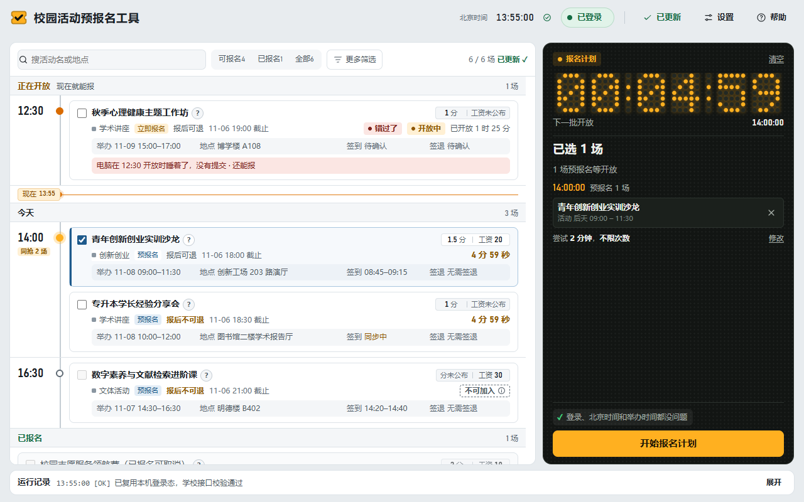
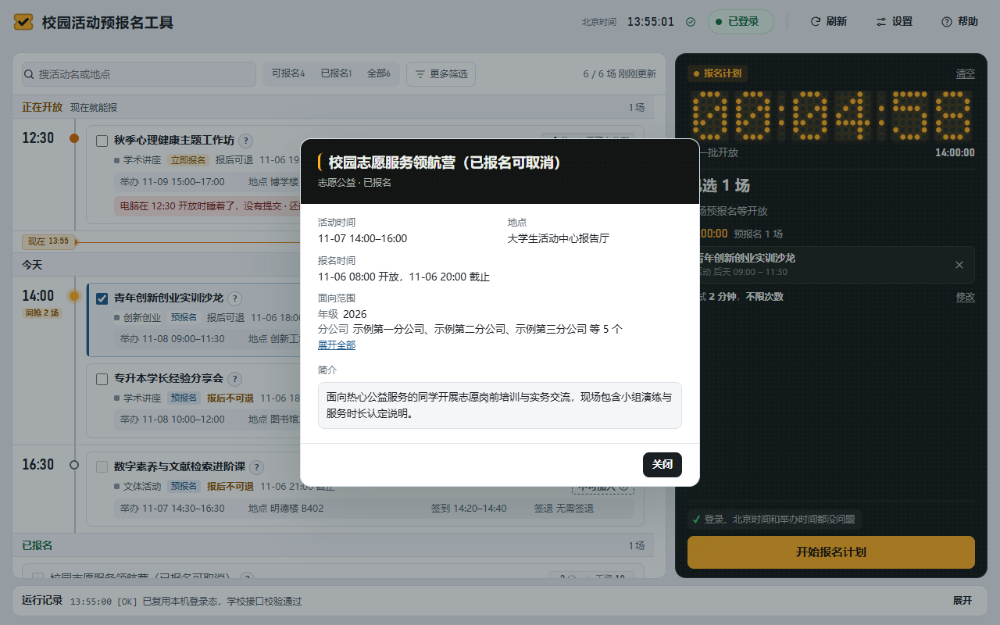
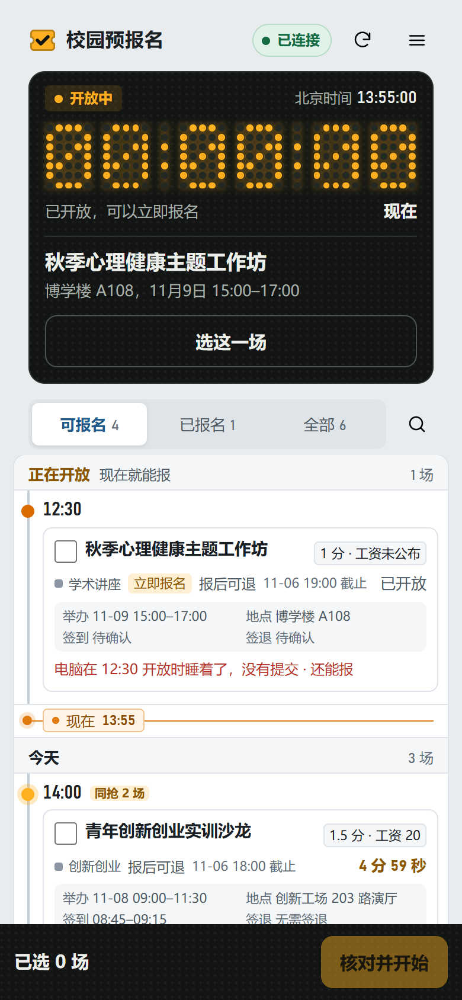

<div align="center">


# 校园活动预报名工具

**把想报的校园活动排进一条时间轴，到开放那一刻自动提交。**

<sub>Windows 桌面端 · 手机遥控 · 飞书提醒 · 服务器版</sub>

<p>
<a href="https://github.com/Env0i/campus-activity-assistant/releases/latest"></a>
<a href="https://github.com/Env0i/campus-activity-assistant/releases"></a>


<a href="LICENSE"></a>
</p>

[下载](#下载) · [界面一览](#界面一览) · [三步上手](#三步上手) · [可选功能](#可选功能) · [常见问题](#常见问题) · [变更记录](CHANGELOG.md)

<br>



</div>

> [!IMPORTANT]
> 这是非官方的个人作品，只适用于一所目标学校的专升本学生端，与学校及其系统运营方没有隶属、合作或授权关系。
> 它只服务你本人的账号：不代他人报名，不做多账号批量占位。学校接口随时可能调整，工具不保证报名成功。

## 核心能力

学生端的活动开放时间分散在一天里的不同时刻。工具把要报的活动排进一条时间轴，在开放那一刻按计划为你提交，你只需要选好场次并让电脑保持开机。

<table>
<tr>
<td width="50%" valign="top">

### 🗓️ 时间轴与四层卡片
活动按报名开放时刻排布成节点，同一时刻有多场未开放时标注「同抢 N 场」。每张卡片分四层展示活动名与奖励、类型标签与报名截止、举办/地点/签到/签退四格，以及冲突或漏报提示；支持搜索与「更多筛选」多选活动类型。

</td>
<td width="50%" valign="top">

### 🔎 活动简介 `?` 浮层
点开活动名旁的 `?` 按钮，即可查看活动时间、地点、报名窗口、面向年级与分公司范围及简介正文，不会误触勾选。简介与面向范围严格按纯文本渲染。

</td>
</tr>
<tr>
<td valign="top">

### ⏱️ 到点自动提交
勾选几场、核对右边计划后点「开始报名计划」。工具按开放时刻自动分批，右侧点阵屏实时倒计时；到点优先直连提交并在短时间内重试，不可用时由页面点击兜底，每场结果单独显示。

</td>
<td valign="top">

### 🚧 冲突拦住与独立北京时间
与已选或已报名活动的举办时段重叠时提前标出并拦住，可取消的已报名场次支持二次确认取消。业务时间采用独立北京时间，由公共网络授时校准，不读不改本机时间；未校准时不让开始计划。

</td>
</tr>
<tr>
<td valign="top">

### 📱 手机遥控与飞书提醒（可选）
开启手机访问后，可经 Tailscale 或 Cloudflare 临时地址查看列表与计划进度、启停计划、输入验证码或重新登录。也可在设置中填入飞书群机器人地址，自动推送报名结果与登录失效提醒。

</td>
<td valign="top">

### 🔐 本地存储，克制少打扰
没有账号体系，不经过开发者服务器，也不含遥测。账号密码默认不保存，选择保存时仅用 Windows 当前用户加密；已有列表刷新时保留旧行与勾选，持续性提示条可收起并在顶栏留一个状态点。

</td>
</tr>
</table>

## 界面一览

<table>
<tr>
<td width="64%" valign="top" align="center">
<br>
<sub>活动简介 <code>?</code> 浮层：时间、地点、报名窗口、面向范围与正文一目了然</sub>
</td>
<td width="36%" valign="top" align="center">
<br>
<sub>手机页：同步采用时间轴布局，配对后才能访问</sub>
</td>
</tr>
</table>

<sub>截图里的活动、地点、范围与时间均为脱敏演示数据。</sub>

## 下载

到 [**Releases**](https://github.com/Env0i/campus-activity-assistant/releases/latest) 下载最新版。单文件和完整 ZIP 是同一份 EXE，安装版装的是同一版本的程序目录，按习惯选一种即可：

| 文件 | 适合谁 |
|---|---|
| **安装版**<br>`campus-activity-watch-installer-vX.Y.Z-win-x64.exe` | **推荐**。中文安装向导；卸载时询问是否一并删除登录数据，默认保留 |
| **单文件**<br>`campus-activity-watch-vX.Y.Z-win-x64.exe` | 不想安装：拷进任意文件夹，双击就能用 |
| **完整 ZIP**<br>`campus-activity-watch-vX.Y.Z-win-x64.zip` | 单文件 EXE 附带使用说明、启动说明和许可，解压即用 |

两个可选组件按需安装：可在「设置 → 高级功能」里一键下载，也可以先从发布页下载，再点「导入已下载的组件包」。

| 组件 | 用来做什么 |
|---|---|
| `campus-activity-watch-phone-control-vX.Y.Z-win-x64.zip` | 手机遥控；内置 Cloudflare 通道所需的 `cloudflared` |
| `campus-activity-watch-relogin-ocr-vX.Y.Z-win-x64.zip` | 验证码识别；保存账号后，登录失效时能自动登回来 |

设置里一键下载时会按需分开下载组件的各个部分，只补变化的部分。

**系统要求**：Windows 10 或 11（64 位），需要 WebView2 运行时（Windows 11 自带，Windows 10 一般已随 Edge 装好）。

> [!NOTE]
> 1.2.1 及更早版本已停止维护，程序里检查更新会提示去发布页，请到发布页手动下载最新版。

> [!TIP]
> 每个版本都附有 `manifest.json`，记录各文件的大小和 SHA-256。下载后可用 PowerShell 的 `Get-FileHash` 核对。

## 三步上手

1. **打开工具，阅读首次说明。** 勾选「我已阅读并同意」后才能登录和报名；不同意也能查看帮助和设置。
2. **登录学校账号。** 两种方式选你放心的那种：
   - **在这里输入**：账号密码直接发给学校，默认不保存。
   - **用学校登录页**：在学校官方页面里输入。
3. **勾选活动，开始报名计划。** 在时间轴里勾选想报的场次，核对右边的计划，点「开始报名计划」。右侧点阵屏会显示倒计时，下面实时显示每场进度。

> [!WARNING]
> 计划由这台电脑执行。运行期间不要关机、睡眠或退出工具；可以最小化，也可以隐藏到右下角托盘。
> 关闭窗口时工具会询问你的选择：最小化、隐藏到后台，还是退出。

结果以学校为准。看到「待核对」时，请到学校活动页确认实际报名状态。

## 可选功能

<details>
<summary><b>📱 手机遥控</b></summary>

<br>

1. 先安装「手机访问」组件（见[下载](#下载)）。
2. 在「设置 → 高级功能 → 手机访问」选择通道并开启，面板会展示二维码和 6 位配对码。
3. 手机扫码打开页面后输入配对码；配对码 5 分钟内有效，仅可使用一次。

| 通道 | 特点 |
|---|---|
| **Tailscale** | 地址固定，重启后无需重新扫码；需要电脑和手机登录同一个 Tailscale 网络 |
| **Cloudflare 临时地址** | 无需另装软件；每次重新开启都会更换地址，需要重新扫码配对 |

> [!NOTE]
> 走 Cloudflare 通道时，手机与电脑之间的全部往来均经 Cloudflare 服务器转发，包括在手机上输入的验证码和账号密码。
> 走 Tailscale 时数据在设备间加密传输；发给手机的运行记录会隐去网址与本机路径。详见[隐私政策](docs/PRIVACY_POLICY.md)第 3 节。

更完整的说明见 [docs/PHONE_ACCESS.md](docs/PHONE_ACCESS.md)。

</details>

<details>
<summary><b>🔁 失效后自动登录</b></summary>

<br>

学校未公开会话保活时长，实测大约 10 到 17 小时。登录详情卡里的「预计有效」按登录后 10 小时估算，仅作提醒，以学校实际校验为准。

在「设置 → 登录」中可按「失效后自动登录 · 还差 N 步」两步清单启用：

1. **保存本机账号密码**：使用 Windows 当前用户加密（DPAPI）保存在本机，随时可清除；
2. **安装验证码识别组件**：用于无人值守识别验证码并恢复登录。

未安装验证码识别组件时，登录失效会提示你回到电脑或手机端手动输入验证码。

</details>

<details>
<summary><b>🔔 飞书提醒（本机版）</b></summary>

<br>

在「设置 → 程序 → 飞书提醒」中填入飞书群自定义机器人 Webhook 地址，并可点击发送测试消息确认送达：

- **自动推送**：报名结果与运行中登录失效时自动发到指定飞书群；
- **完全可选**：不填写地址就不会向飞书发起任何请求，保存时只更新这一项配置。

</details>

## 数据与隐私

- **存在哪**：登录凭据、活动缓存、设置和运行记录都在 `%LOCALAPPDATA%\TianSoftActivityPreRegistration\data`。升级版本或重新安装不会丢失，删除该目录即可全部清除。
- **连哪里**：常规对外通信仅四类——学校系统、公共网络授时服务、你主动点击检查更新或下载组件时访问 GitHub、你开启手机访问时经所选通道；如额外配置了本机飞书提醒，则仅在你配置后向你填写的飞书群机器人地址发送通知。不含开发者侧遥测或统计。
- **更新**：只在你点击「检查更新」时联网查询；下载安装包后会先核对文件大小和 SHA-256，是否安装由你决定，不会静默自升级。

完整条款见[用户协议](docs/USER_AGREEMENT.md)和[隐私政策](docs/PRIVACY_POLICY.md)。条款修订后会请你重新确认。

## 常见问题

<details>
<summary><b>会不会被学校封号？</b></summary>

<br>

工具只操作你自己的账号，只在开放时刻短时间内提交你选好的场次。但学校登录页的协议里没有关于脚本或自动化的条款，工具不声称合规，用不用、怎么用由你自己判断。

</details>

<details>
<summary><b>电脑时间不准能用吗？</b></summary>

<br>

能。工具用的是独立的北京时间，不读也不改你电脑的时间。顶栏会显示北京时间是否已校准；校准不了时，登录和查看活动照常，只是暂时不能开始报名。

</details>

<details>
<summary><b>在手机上登了学校页面，电脑这边会掉线吗？</b></summary>

<br>

可能会，也可能不会，以实际登录状态为准。反过来，用本工具登录也可能让同一账号在别处的登录失效。掉线了点「重新登录」即可；计划运行中登录失效，工具会提醒你。

</details>

<details>
<summary><b>报名结果是「待核对」怎么办？</b></summary>

<br>

说明提交后学校的回答不明确，工具没法确认。到学校活动页看一眼就知道实际是否报上。

</details>

<details>
<summary><b>可以开两份，或者帮室友报名吗？</b></summary>

<br>

都不行。同一台电脑只运行一份，再次打开会切回已经开着的窗口，免得同一场提交两遍。多账号代报属于占位，会挤掉其他同学的名额，请让室友在自己的电脑上用自己的账号。

</details>

<details>
<summary><b>换电脑或重装系统，要注意什么？</b></summary>

<br>

保存的账号密码用 Windows 当前用户加密，换电脑或换用户后解不开，在新电脑上重新登录一次即可。

</details>

## 服务器版（自行部署）

<details>
<summary>用飞书机器人定时推送活动、群里 @ 查询、私聊预报名与查退选</summary>

<br>

仓库里的 `server/` 是另一个独立版本，运行在常驻 Linux 上：每天定时把「今天要参加的」「即将开放报名的」活动整理成卡片推到飞书群，支持在群里 `@` 机器人只读查询；部署者本人还可在私聊里预报名（自动校验举办时段冲突）、查询已报名场次、两步确认取消，以及接收活动临近开始、签退和关注场次变动提醒。

| 需要 | 说明 |
|---|---|
| 一台 7×24 的 Linux | Ubuntu 22.04，Python 3、Node 20、cron、systemd |
| 飞书应用 | 只推送可用群机器人；需 `@` 查询和私聊自助管理时使用企业自建应用 |

按顺序阅读：[飞书机器人](docs/FEISHU_BOT.md) → [配置](docs/CONFIG.md) → [部署与运维](docs/OPERATIONS.md)。

</details>

## 从源码运行与项目结构

<details>
<summary>开发者看这里</summary>

<br>

需要 Windows 10/11 与 Python 3.10 或更高版本（开发与测试统一使用 3.12）。

```bash
git clone https://github.com/Env0i/campus-activity-assistant.git
cd campus-activity-assistant
python -m pip install -r local/requirements.txt
python -m playwright install chromium

# 不登录，用脱敏演示数据启动界面
python local/app.py --demo

# 本机版全量测试（不联网）
python -m unittest discover -s local/tests -p "test_*.py"
```

真实站点地址仅从环境变量 `SCHOOL_ORIGIN` 读取，不写进仓库。打包与发版使用 `tools/release/release.py`：不带参数做只读检查，`--prepare` 在本地构建全部产物，`--publish` 需满足干净主分支与人工确认后才对外发布。

参与开发前请先阅读 [AGENTS.md](AGENTS.md)（授权边界、提交规范、测试注意事项），整体架构见 [docs/ARCHITECTURE.md](docs/ARCHITECTURE.md)。

```
├── local/       本机版：桌面界面（local/ui/features/ 与基础层）、报名 worker、打包脚本
├── server/      服务器版：定时推送、飞书机器人、systemd/cron 部署文件
├── contracts/   学校接口的脱敏样例
├── docs/        工程文档：架构、登录、报名、配置、运维与条款
├── design/      产品决策、规格、界面原型与验收截图
└── tools/       发版脚本、代码结构门禁（tools/code_shape/）与 QA 检查
```

| 文档 | 内容 |
|---|---|
| [docs/ARCHITECTURE.md](docs/ARCHITECTURE.md) | 数据流、分层职责、接口清单 |
| [docs/LOGIN.md](docs/LOGIN.md) | 登录态、校验与自动重新登录 |
| [docs/GRAB.md](docs/GRAB.md) | 报名链路与结果判定 |
| [docs/PHONE_ACCESS.md](docs/PHONE_ACCESS.md) | 手机访问通道、配对与安全边界 |
| [docs/UI_SPEC.md](docs/UI_SPEC.md) | 界面与前后端契约 |
| [design/decisions/](design/decisions/) | 已拍板的产品决策记录 |

</details>

## 许可

[MIT](LICENSE)

<div align="center">
<sub>校园活动预报名工具 · 非官方个人作品 · 只服务本人账号</sub>
</div>
