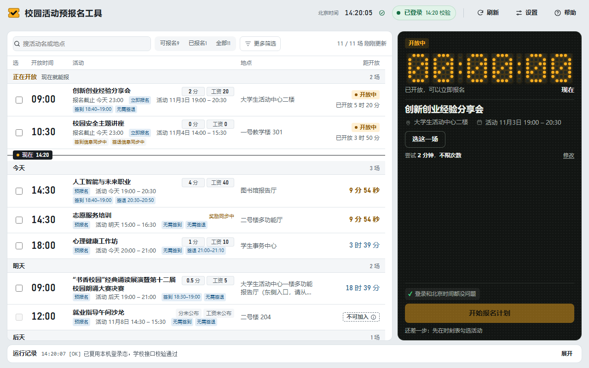
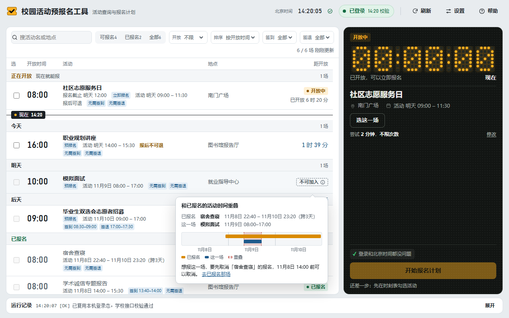
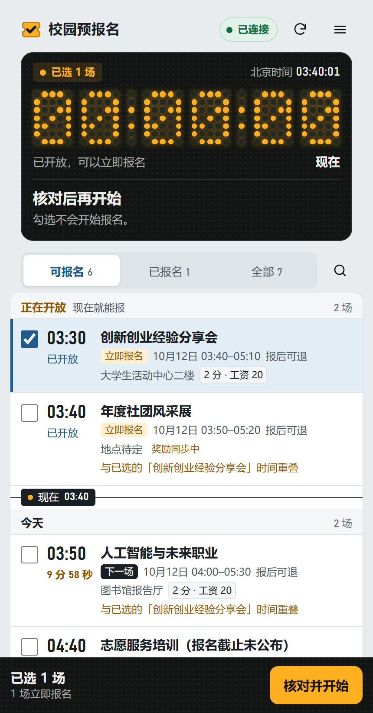

<div align="center">


# 校园活动预报名工具

**把想报的校园活动排进一张时刻表，到开放那一刻自动提交。**

[](https://github.com/Env0i/campus-activity-assistant/releases/latest)
[](https://github.com/Env0i/campus-activity-assistant/releases)

[](LICENSE)

[下载](#下载) · [三步上手](#三步上手) · [常见问题](#常见问题) · [用户协议](docs/USER_AGREEMENT.md) · [隐私政策](docs/PRIVACY_POLICY.md) · [变更记录](CHANGELOG.md)



</div>

> [!IMPORTANT]
> 这是非官方的个人作品，只适用于一所目标学校的专升本学生端，与学校及其系统运营方没有隶属、合作或授权关系。
> 它只服务你本人的账号：不代他人报名，不做多账号批量占位。学校接口随时可能调整，工具不保证报名成功。

## 它能帮你做什么

学生端的活动一开放就要抢，开放时间又分散在一天里的不同时刻。这个工具把要报的活动排进一张时刻表，到点替你提交，你只需要选好、开着电脑。

<table>
<tr>
<td width="50%" valign="top">

### 🗓️ 一张时刻表
活动按报名开放时间分组：正在开放、今天、明天、后天……每行写清举办时段、地点、签到签退要求、实践分和虚拟工资。可以搜索、按开放时间和签到要求筛选。只列还能报的，以及你已报名、活动还没结束的。

</td>
<td width="50%" valign="top">

### ⏱️ 到点自动提交
勾选几场，核对右边的计划，点「开始报名计划」。工具按开放时刻分批，到点直接向学校提交，开放瞬间会在短时间内多次尝试，页面点击只在直接提交不可用时兜底。每场结果单独显示。

</td>
</tr>
<tr>
<td valign="top">

### 🚧 冲突提前拦住
和已选、已报名活动的举办时间重叠，会提前标出来。鼠标停在「不可加入」上，能看到双方时段的时间条和解决办法。还能取消的已报名场次，可以在电脑上取消：先二次确认，结果以向学校复查为准。

</td>
<td valign="top">

### 🕰️ 独立北京时间
用公共网络授时校准，不读也不改你电脑的时间设置。北京时间没校准好时不让开始报名，免得掐错点；登录和查看活动不受影响。

</td>
</tr>
<tr>
<td valign="top">

### 📱 手机遥控（可选）
经 Tailscale 或 Cloudflare 临时地址，用手机看活动和计划进度、开始或停止计划、输入验证码、重新登录。默认关闭，不开就不监听任何端口。

</td>
<td valign="top">

### 🔐 数据只在你的电脑上
没有账号体系，没有遥测，不经过任何开发者的服务器。账号密码默认不保存；选择保存时用 Windows 当前用户加密，只有这台电脑能解开。

</td>
</tr>
</table>

<table>
<tr>
<td width="62%" valign="top" align="center">
<br>
<sub>和已报名活动时间重叠时，气泡里画出双方时段，并写清怎么解决</sub>
</td>
<td width="38%" valign="top" align="center">
<br>
<sub>手机页：和电脑同一份数据，配对后才能访问</sub>
</td>
</tr>
</table>

<sub>截图里的活动、地点和时间都是演示数据。</sub>

## 下载

到 [**Releases**](https://github.com/Env0i/campus-activity-assistant/releases/latest) 下载最新版。三种形态的程序本体是同一份 EXE，选一种就够：

| 文件 | 适合谁 |
|---|---|
| **安装版**<br>`campus-activity-watch-installer-vX.Y.Z-win-x64.exe` | 推荐。中文安装向导；卸载时会问要不要一并删除登录数据，默认保留 |
| **单文件**<br>`campus-activity-watch-vX.Y.Z-win-x64.exe` | 不想安装：拷进任意文件夹，双击就能用 |
| **完整 ZIP**<br>`campus-activity-watch-vX.Y.Z-win-x64.zip` | 单文件 EXE 加使用说明和协议，解压即用 |

两个可选组件，需要时再装：在「设置 → 高级功能」里一键下载，或者先从发布页下载，再点「导入已下载的组件包」。

| 组件 | 用来做什么 |
|---|---|
| `campus-activity-watch-phone-control-vX.Y.Z-win-x64.zip` | 手机遥控；内置 Cloudflare 通道用的 cloudflared |
| `campus-activity-watch-relogin-ocr-vX.Y.Z-win-x64.zip` | 验证码识别；保存账号后，登录失效时能自动登回来 |

**系统要求**：Windows 10 或 11（64 位），需要 WebView2 运行时（Windows 11 自带，Windows 10 一般已随 Edge 装好）。

> [!TIP]
> 每个版本都附有 `manifest.json`，里面记着每个文件的大小和 SHA-256。下载后可以用 PowerShell 的 `Get-FileHash` 核对。

## 三步上手

1. **打开工具，读首次说明。** 勾选「我已阅读并同意」后才能登录和报名；不同意也能看帮助和设置。
2. **登录。** 两种方式，选你放心的那种：
   - **在这里输入**：账号密码直接发给学校，默认不保存。
   - **用学校登录页**：在学校官方页面里输入。
3. **勾选活动，开始报名计划。** 在时刻表里勾选想报的场次，核对右边的计划，点「开始报名计划」。到点会自动提交，右边的点阵屏显示倒计时，下面是每场的进度。

> [!WARNING]
> 计划由这台电脑执行。运行期间不要关机、睡眠或退出工具；可以最小化，也可以隐藏到右下角托盘。
> 关窗口时工具会问你：最小化、隐藏到后台，还是退出。

结果以学校为准。看到「待核对」时，到学校活动页确认一下。

## 可选功能

<details>
<summary><b>📱 手机遥控</b></summary>

<br>

1. 先装「手机控制」组件（见[下载](#下载)）。
2. 在「设置 → 高级功能 → 手机访问」选一种通道，点「开启手机访问」，面板会显示二维码和 6 位配对码。
3. 手机先扫二维码打开页面，再输入配对码。配对码 5 分钟内有效，只能用一次。

| 通道 | 特点 |
|---|---|
| **Tailscale** | 地址固定，重启后不用重新扫码；需要电脑和手机都装好、登录同一个 Tailscale 网络 |
| **Cloudflare 临时地址** | 不用另装软件；每次重新开启都会换地址，要重新扫码配对 |

> [!NOTE]
> 走 Cloudflare 通道时，手机和电脑之间的全部往来都经 Cloudflare 的服务器转发，包括你在手机上输入的验证码和账号密码。
> 走 Tailscale 时数据在设备之间加密传输。发给手机的运行记录会隐去网址和本机路径。详见[隐私政策](docs/PRIVACY_POLICY.md)第 3 节。

更完整的说明见 [docs/PHONE_ACCESS.md](docs/PHONE_ACCESS.md)。

</details>

<details>
<summary><b>🔁 登录失效后自动登回来</b></summary>

<br>

学校不公布登录能保持多久，实测大约 10 到 17 小时。登录详情卡里的「预计有效」按登录后 10 小时估算，只作提醒，以学校的实际校验为准。

想在失效后自动登回来，需要两样：

- 在「设置 → 登录」里保存账号密码（用 Windows 当前用户加密，随时可清除）；
- 装好「验证码识别」组件。

没装验证码识别组件时，失效后会提示你重新登录，验证码由你在电脑或手机上手动输入。

</details>

## 数据与隐私

- **存在哪**：登录凭据、活动缓存、设置和运行记录都在 `%LOCALAPPDATA%\TianSoftActivityPreRegistration\data`。换新版本、重新安装都不会丢，删掉这个文件夹就全部清除。
- **连哪里**：只有四类对外通信——学校系统；网络授时服务；你点检查更新或下载时访问 GitHub；你开启手机访问时经你选的通道。没有遥测和统计。
- **更新**：只在你点「检查更新」时联网查询。下载安装包后会先核对大小和 SHA-256，什么时候安装由你决定，工具不会自己升级。

完整内容见[用户协议](docs/USER_AGREEMENT.md)和[隐私政策](docs/PRIVACY_POLICY.md)。条款改版后，程序会请你重新同意一次。

## 常见问题

<details>
<summary><b>会不会被学校封号？</b></summary>

<br>

工具只操作你自己的账号，只在开放时刻短时间内提交你选好的场次。但学校登录页的协议里没有关于脚本或自动化的条款，工具不声称合规，用不用、怎么用由你自己判断。

</details>

<details>
<summary><b>电脑时间不准能用吗？</b></summary>

<br>

能。工具用的是独立的北京时间，不看也不改你电脑的时间。顶栏会显示北京时间是否已校准；校准不了时，登录和查看活动照常，只是暂时不能开始报名。

</details>

<details>
<summary><b>在手机上登了学校页面，电脑这边会掉线吗？</b></summary>

<br>

可能会，也可能不会，以实际登录状态为准。反过来，用本工具登录可能让同一账号在别处的登录失效。掉线了点「重新登录」即可；计划运行中登录失效，工具会提醒你。

</details>

<details>
<summary><b>报名结果是「待核对」怎么办？</b></summary>

<br>

说明提交后学校的回答不明确，工具没法确认。到学校活动页看一眼就知道报没报上。

</details>

<details>
<summary><b>可以开两份，或者帮室友报名吗？</b></summary>

<br>

都不行。同一台电脑只运行一份，再次打开会切回已经开着的窗口，免得同一场提交两遍。多账号代报属于占位，会挤掉其他同学的名额，请让室友在自己的电脑上用自己的账号。

</details>

<details>
<summary><b>换电脑或重装系统，要注意什么？</b></summary>

<br>

保存的账号密码用 Windows 当前用户加密，换电脑或换用户后解不开，在新电脑上重新登录一次即可。

</details>

## 服务器版（自行部署）

<details>
<summary>用飞书机器人定时推送活动、群里 @ 查询、私聊预报名</summary>

<br>

仓库里的 `server/` 是另一个独立的版本：跑在一台常驻的 Linux 上，每天定时把「今天要参加的」「即将开放报名的」活动整理成卡片推到飞书群，可以在群里 @ 机器人查询，部署者本人还可以在私聊里点「预报名」，到点自动报名。

| 需要 | 说明 |
|---|---|
| 一台 7×24 的 Linux | Ubuntu 22.04，Python 3、Node 20、cron、systemd |
| 飞书应用 | 只推送用群机器人；要 @ 查询和私聊预报名，需要企业自建应用 |

按顺序看：[飞书机器人](docs/FEISHU_BOT.md) → [配置](docs/CONFIG.md) → [部署与运维](docs/OPERATIONS.md)。

</details>

## 从源码运行

<details>
<summary>开发者看这里</summary>

<br>

需要 Windows 10/11 和 Python 3.10 或更高（测试统一用 3.12）。

```bash
git clone https://github.com/Env0i/campus-activity-assistant.git
cd campus-activity-assistant
python -m pip install -r local/requirements.txt
python -m playwright install chromium

# 不登录，用演示数据看界面
python local/app.py --demo

# 本机版全量测试（不联网）
python -m unittest discover -s local/tests -p "test_*.py"
```

真实站点地址只从环境变量 `SCHOOL_ORIGIN` 读，不写进仓库。打包和发版用 `tools/release.py`：不带参数只做只读检查，`--prepare` 在本地构建全部资产，`--publish` 才对外发布。

参与开发前请先读 [AGENTS.md](AGENTS.md)（授权边界、提交规范、测试注意事项），架构见 [docs/ARCHITECTURE.md](docs/ARCHITECTURE.md)。

```
├── local/       本机版：图形界面（local/ui/）、报名 worker、打包脚本
├── server/      服务器版：定时脚本、飞书机器人、部署文件
├── contracts/   学校接口的脱敏样例
├── docs/        工程文档：架构、登录、报名、配置、运维、条款
├── design/      产品决策、规格、界面原型与验收截图
└── tools/       发版与 QA 脚本
```

| 文档 | 内容 |
|---|---|
| [docs/ARCHITECTURE.md](docs/ARCHITECTURE.md) | 数据流、模块职责、接口清单 |
| [docs/LOGIN.md](docs/LOGIN.md) | 登录态、校验与自动重新登录 |
| [docs/GRAB.md](docs/GRAB.md) | 报名链路与结果判定 |
| [docs/PHONE_ACCESS.md](docs/PHONE_ACCESS.md) | 手机访问的通道、配对与安全边界 |
| [docs/UI_SPEC.md](docs/UI_SPEC.md) | 界面与接口契约 |
| [design/decisions/](design/decisions/) | 已拍板的产品决策 |

</details>

## 许可

[MIT](LICENSE)

<div align="center">
<sub>校园活动预报名工具 · 非官方个人作品 · 只服务本人账号</sub>
</div>
