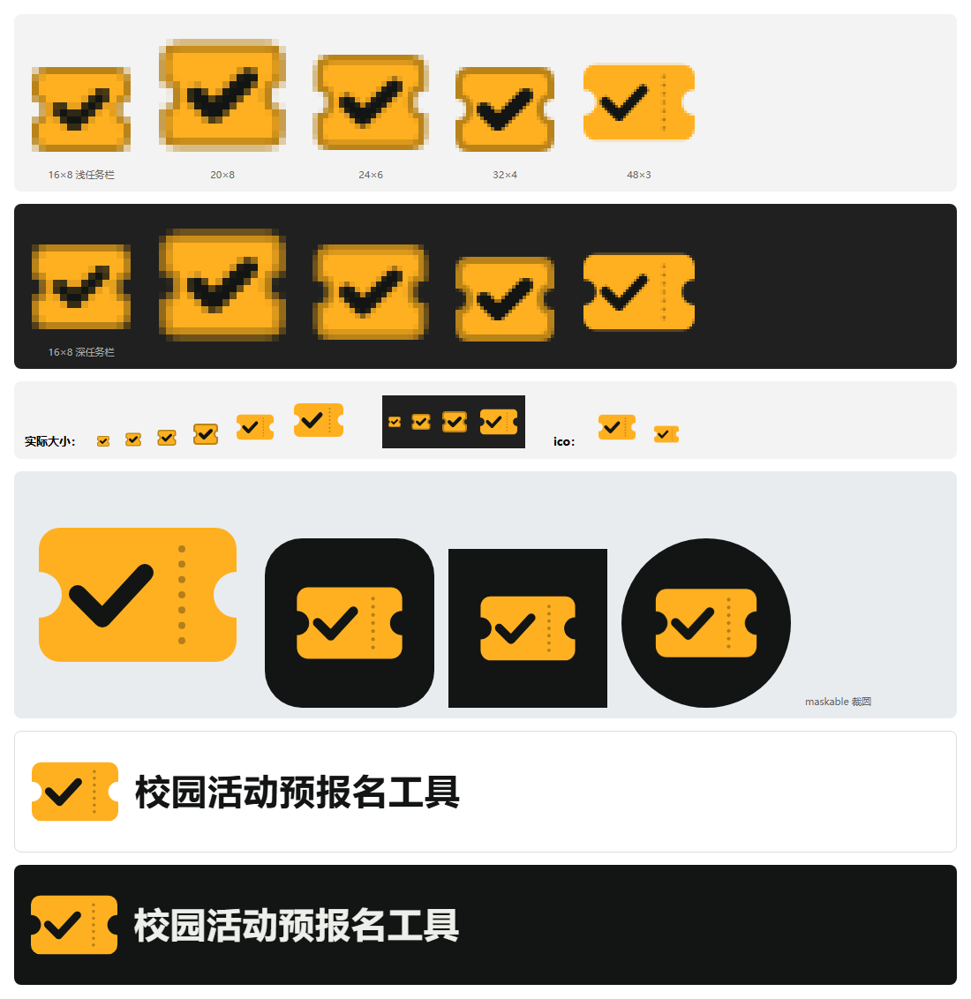

# Logo 资产 · 入场券

用户 2026-11-02 选定。还没有接进程序，接入点见文末。



## 含义

琥珀色的票、两侧的缺口、撕线、墨黑的勾：**报上了，就是拿到了一张票**。

- 外形：用户在第二轮四个方向（入场券、钟面勾、日历勾、书签时钟）里选的。不再用界面左上角原来那个“深色方块加两颗圆点”。
- 配色：沿用界面的琥珀和墨黑，不另起一套。

## 文件和用在哪

| 文件 | 用在哪 |
|---|---|
| `ico/app.ico` | EXE、安装包、托盘、窗口图标。含 16、20、24、32、40、48、64、256 八个尺寸 |
| `ico/favicon.ico` | 网页标签图标（16、32、48） |
| `svg/logo.svg` | 主标志，40 像素及以上 |
| `svg/logo-small.svg` | 小尺寸版，32 像素及以下（按 16 像素网格对齐，缺口收小，去掉撕线，外圈 1 像素深琥珀边） |
| `svg/logo-tile.svg` | 带深色圆角底板，需要方形图标的地方 |
| `svg/logo-tile-square.svg` | 满版方形：iOS 主屏、Android 自适应图标（系统自己裁圆角，票面在安全区内） |
| `svg/logo-mono.svg` · `svg/logo-mono-white.svg` | 单色版（墨黑 / 白），勾和撕线镂空；只能用一种颜色时用 |
| `svg/lockup.svg` · `svg/lockup-dark.svg` | 横版标志（图形加中文全称），分浅色底和深色底两版 |
| `png/logo-{16…1024}.png` | 各尺寸透明底 PNG，≤32 来自小尺寸版，≥40 来自主标志 |
| `png/apple-touch-icon.png` | 180 像素，手机页“添加到主屏幕” |
| `png/tile-192.png` · `png/tile-512.png` | 网页应用清单里的普通图标 |
| `png/maskable-512.png` | 网页应用清单里的 maskable 图标 |
| `png/lockup*.png` | 横版标志的 1 倍和 2 倍渲染图，对外使用优先用它（见下） |

## 规则

**尺寸**

- 32 像素及以下一律用小尺寸版。主标志缩到这么小，撕线会糊、勾会变细。
- 20 像素只在 125% 缩放的托盘里出现，略糊属正常：16 像素网格缩放到 20 落不到整像素。

**颜色**

| 用途 | 色值 |
|---|---|
| 票面 | `#FFB020` |
| 勾和撕线 | `#121513`（撕线 32% 不透明度） |
| 小尺寸外圈 | `#B98319` |
| 深色底板 | `#121513` |

**留白和最小尺寸**

- 四周至少留出缺口那么宽的空白（约为票高的 1/6）。
- 最小 16 像素。

**不要这样用**

- 旋转、拉伸、加阴影或渐变。
- 把票面换成别的颜色，或者给勾换颜色。
- 放在琥珀色或其他高饱和底色上。
- 去掉勾，只留票。

**横版标志的文字**

- SVG 里的文字用系统字体（微软雅黑 UI），换了没有这款字体的电脑会变样。
- 对外发布、放进 README 或 Release 页时，用 `png/lockup*.png`。

**.ico 的一个限制**

- 256 像素那一帧是 PNG 格式，资源管理器、EXE 和安装包都认。
- .NET 的 `System.Drawing.Icon` 读不了 PNG 帧，会退回到 64 像素。托盘只用 16 到 32 像素，不受影响。

## 重新导出

改了 `svg/` 里的源文件后，在仓库根运行：

```bash
node design/brand/tools/export.js
```

工具的做法：

- 用无头 Edge 透明背景按精确像素栅格化，再裁切成各尺寸 PNG，打包两个 `.ico`。
- 只用 Node 自带模块，不引入依赖。
- 中间文件写系统临时目录，不落进仓库。
- Edge 不在默认位置时，用环境变量 `EDGE_PATH` 指定。

## 接入点（还没做）

这些改动属于界面实现，等[新工作台计划](../../docs/superpowers/specs/2026-11-02-workbench-ui-redesign-design.md)修补后一起做：

| 位置 | 现在 | 改成 |
|---|---|---|
| `local/build/build_exe.py` | 没给图标，用打包工具默认图标 | 打包时指定 `ico/app.ico` |
| `local/build/build_installer.py` | 安装包没设图标 | 安装包和卸载项都用 `ico/app.ico` |
| `local/infrastructure/tray_icon.py` | `SystemIcons.Application`（系统默认图标） | 从 `ico/app.ico` 读图标；读不到再退回系统图标 |
| `local/ui/index.html` | 顶栏内联的旧标志（深色方块加两颗圆点） | 换成 `svg/logo-small.svg` 的内联图形 |
| `local/ui/m/index.html` | 没有任何图标 | 加 `favicon.ico` 和 `apple-touch-icon.png` |

图标文件要随程序一起打包，打包脚本需要把用到的文件复制进构建产物。
