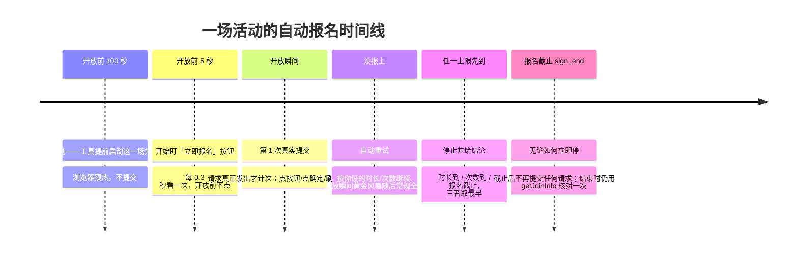
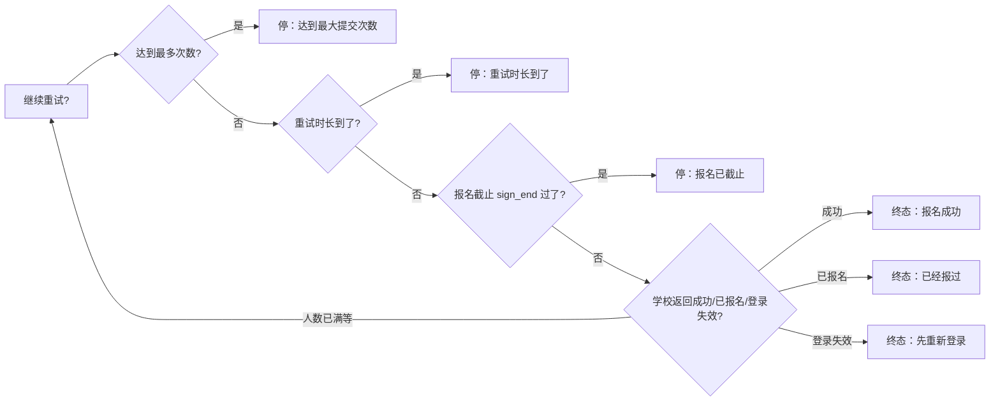

# 报名重试策略图解（RETRY_POLICY_GUIDE）

给普通使用者看的规则手册：工具在报名开放后会自动重试多久、重试几次、什么时候坚决停。
配套界面说明见 [../local/README.md](../local/README.md)；给开发者的契约在
[UI_SPEC.md](UI_SPEC.md) §5.8。**本工具只服务校园智慧校园单校账号**，不做多学校抽象。

---

## 一句话规则

**报名截止时间（sign_end）是硬上限；你设置的「重试时长」和「最多次数」谁先到谁停；
默认只重试 2 分钟、不限次数，不会默认挂两天。时长选「直到报名截止」时，截止就是唯一上限。**

## 报名窗口与重试时间线

**起算点分两种**：未来场次从学校原定开放时刻起算；已经开放的场次从「计划被接纳的
那一刻」起算——解包、鉴权、校时、开页花掉的时间都算在你设的时长里，页面加载慢
不会把截止整体后移。时长用单调时钟计，系统时间被回拨也不会变长。

**次数只认真正发出去的提交**：点了按钮但没点「确定」、确认框失败、页面刷新、
「是否已报名」查询都不计数。请求一发出就计一次并立刻上报，所以还能继续发的场次里，你能
看到「已提交 1/3 次」在涨；如果最后一次请求发出后没有响应，结论是
「结果未确认，请到活动页核对」，不会替你断言没抢到——已发出的请求撤不回来。

时间线上的五个节点要分清哪些是**计划时间**、哪些是**实际事件**：

| 节点 | 来源 |
|---|---|
| 计划准备时刻 | 计划算出来的（原定开放前 100 秒），路线图不显示它当事件 |
| 本次启动 | worker 真正启动那一刻（实际事件时间） |
| 活动页已打开 | 详情页真正加载完成（实际事件时间；没发生就显示「待打开」） |
| 盯按钮 | 真正进入按钮监视（实际事件时间；没发生就显示「待发生」） |
| 原定开放 | 学校给的 `sign_start`，只是参考节点，不因提前准备而改变 |
| 本次重试到 | 重试截止=起算点+你设的时长，被 sign_end 截断 |

两点保证：

1. **界面只显示真实事件**：路线图上「活动页已打开」「盯按钮」没发生时显示「待打开 / 待发生」，
   不会拿计划时间或当前时间编一个看起来像发生过的时刻。
2. **慢页面不吃掉重试窗口**：重试起算点在打开页面前就固定了——已开放场次从 worker 启动
   时刻起算，页面加载慢几十秒，你设置的 10 分钟还是完整的 10 分钟。

三个上限的关系（取最早的那个）：

## 提交节奏：黄金风暴与 404 自适应（2026-10-28 修订）

报名开放瞬间的节奏分三段，按学校实际应答自动切换：

| 阶段 | 什么时候 | 节奏 | 说明 |
|---|---|---|---|
| **黄金风暴** | 开放后 0~1.6 秒 | 最多 10 轮，间隔 90ms | 开放瞬间冲一波；只要收到真实应答立即转入常规全速 |
| **常规全速** | 黄金之后 | 每 180ms 一轮 | 持续到时长/次数/截止任一先到 |
| **404 自适应** | 连续 3 次 404 | 纯 404 段不切相位、只扩窗；持续 20 秒后降到 0.8 秒地板；连击含 429 → 1.6 倍指数退避，上限 3 秒 | 404/429 表示接口还没就绪或被限流：连续 3 次 404 只把有效窗口扩到起点起 25 分钟（不切退避相位），纯 404 段持续超过 20 秒后最小间隔缓到 0.8 秒；连击中出现 429 才进入 1.6 倍指数退避（上限 3 秒）并同样扩窗；收到任何非 404/429 真实应答立即回全速 |

几条硬规则：

1. **sign_end 永远是硬截止**：25 分钟自适应扩窗也只能到 sign_end 为止，绝不越过报名截止。
2. **不承诺必抢到**：高频请求只是提高发出速度，不保证学校一定有名额。
3. **不隐藏重复提交**：每笔真实发出的 signUp 请求都有唯一编号并如实计数；一次动作发出多次也会按真实次数入账。
4. **未决不伪造成失败**：请求发出去但没拿到确定应答（断网、超时、读不出响应体），这笔一直算「未决」；停止时如实报「结果未确认，请到活动页核对」，不会替你断言没抢到。
5. **多笔未决合法**：黄金风暴期间可能有多笔请求在途，应答可以乱序回来，每笔按自己的编号结算。
6. **5xx 有 0.5 秒地板**：服务端 5xx 之后下一笔至少隔 0.5 秒；5xx 断开 404 连击、不进退避相位。
7. **404/429 没有真实样本**：扩窗、0.8 秒地板、1.6 倍退避都沿用旧规则，**未验证**；
   真遇到时以日志为准再调。

三种「没报上」要分清：

| 现象 | 工具在做什么 | 你会看到的文案 |
|---|---|---|
| 按钮一直没出现 | 按退避节奏刷新页面，不点也不提交 | 「还没看到立即报名按钮」 |
| 活动已开放、正在准备 | 已进入详情页，等待第一次真实提交 | 立即模式「现在抢名额」；预报名在开放前显示「等待开放」 |
| 提交发出但没确定回应 | 可继续发（多笔未决），停止时保留次数 | 「结果待核对」+ 已提交次数 |

「提前 100 秒打开页面」只在**预报名**（原定开放时刻还没到）时成立；活动已经开放时
工具直接以本次启动时刻为起点立即抢名额，文案不会再写「提前打开」。

### 适用范围：本机工具与服务器 owner 预报名共用，但外壳独立

上面这张节奏表是本机工具和**服务器 owner 私聊预报名**共用的策略契约（阶段、
字段一致；两边独立实现、互不导入，不是同一个进程）。服务器那一套的链路是：
飞书卡片写入预报名清单 → `watchlist_runner` 到点拉起 `server/deploy/grab_signup.py`，
其中 3×404 语义，服务器部署副本尚未同步本节修订（仍为旧版：连续 3 次 404
即进退避相位），同步前以本表描述的本地实现为准。每笔请求同样唯一编号、如实
计数。除此之外，差异只在运行外壳：

- **登录**：服务器由登录守护自动续期、失效自动重登，不需要人工点「重新登录」；
- **来源**：预报名来自 owner 私聊卡片按钮（清单文件），不是本机界面；
- **通知**：结果只私聊 owner 本人，不发群、不走 Webhook；
- **停止/取消**：取消预报名是把场次从清单删掉；已在跑的那场沿用服务器语义收口，
  未决请求照样如实报「结果未确认」。

群查询与 Webhook 推送**不受黄金风暴影响**：群内依旧只读，任何一张群卡片都没有
报名或重试按钮。

## 回包分类与终态（决策 015）

学校把业务结果放在 HTTP 200 的 `code` 与 `message` 里。工具按 `code` 加 `message` 里的
关键短语归类，不要求整句相等；**日志记学校完整原文**，界面只显示短结论。
分类函数是 `local/domain/signup_reply.py` 的 `classify_signup_reply`，规则出处见
[决策 015](../design/decisions/015-signup-path-and-replies.md) 与
[架构修订设计](superpowers/specs/2026-11-03-architecture-revision-design.md) 3.3 节。

| 回包 | 本场怎么处理 |
|---|---|
| `code=1` 成功 | 立即结束，结论「报名成功」 |
| 「报名未开始」 | 还没开门，继续按节奏发；开抢前收到时不计次（预检不进次数账本） |
| 「报名人数已满」 | **本场结束**，结论「名额已满」；不重试硬扛 |
| 「活动时间与已参与活动时间冲突」 | 结束；收尾 `getJoinInfo` 核对到已报名则改判成功 |
| 「报名已结束」 | 结束，结论「报名已截止」 |
| 「版本不兼容」 | 重取一次运行时密钥再算；仍然不兼容就退回点击 |
| 「您的请求已超时」 | 重新校时再算；连续 2 次结束，结论「本机时钟不准」 |
| 「Cache 'hd-info'」 | 直发时先退回点击核实；点击上也这样才结束，结论「活动不存在」 |
| `4001` / 登录失效 | 先复查一次，见「登录失效先复查」 |
| 没见过的文案 | 直发时连续 3 次退回点击；点击上再 3 次结束，结论「学校回了无法识别的结果」 |

决定性说明：
- **名额已满是正常结束**，不是工具故障（2026-11-03 用户定为终态）。
- **退回点击的三个条件**：取不到运行时密钥；重取密钥后仍「版本不兼容」；
  同一条未识别文案连续 3 次。每场都会写日志说明走哪条路、为什么。
- HTTP 404 / 429 没有真实样本，沿用上面的自适应规则，见「未验证」标记。

## 「第 N 次提交」是什么

- **只有真正发出去的 signUp 请求，才计一次**（直发由本工具自己发，点击由一次真实点击发一条；RISK-001 已关闭，见下文）；
- 页面刷新、等待、查「是不是已经报上了」**都不算**；
- 所以任务卡上的「已提交 3 次 · 学校回了无法识别的结果」= 真的向学校交了 3 次；
- 设了次数上限时显示「已提交 2/3 次」；上限填 0（不限）时显示「已提交 3 次（不限次数）」。
  这个分母是你设的策略，不是学校的名额总数。

### 页面自发请求不计数（RISK-001，已关闭 2026-11-03）

原风险：旧实现把整个提交阶段的页面请求都计入，页面自己发出的同路径 `signUp` 可能被当成一次提交，
让「已提交 N 次」和「报名成功」失去因果依据。现在两条路径都不再有这个缺口：

| 路径 | 现在怎么记账 | 证据 |
|---|---|---|
| 直发 | 不监听页面请求，只按本次自己发出的请求计数 | [架构修订设计](superpowers/specs/2026-11-03-architecture-revision-design.md) 3.6；2026-11-03 两次直发拿到真实 `code=1`（live-check 第 28、40 节） |
| 点击 | 一次真实点击只发 1 条 `signUp`，点击前后静置期 0 条 | live-check 第 35 节（点击后观察 10 秒仍为 1 条）、第 36 节结果三（点击前 40 秒 0 条、点击后 10 秒无第二条） |

**关闭依据**：用户 2026-11-03 定「RISK-001 关闭」；设计 3.6 给出实现口径，
live-check 的两次独立点击样本和两次直发成功样本支撑记账口径。

**剩余缺口与兜底**：开放那一秒页面打不开（live-check 第 36 节结果一），
那一秒页面会不会自己发 `signUp` 仍未观测。这个缺口由每场结束的 `getJoinInfo`
终态核对兜住（设计 3.5）：已报名算成功，未报名按实际回包给结论。

**结论怎么读**：「报名成功」仍只表示「学校回过一笔 `code=1`，且终态核对确认已报名」；
它不再被 RISK-001 压成 blocked/unproven，但也不替你确认其他设备或入口的行为。

## 点「停止」到底停什么

停止只结束**本机这一场的执行**，不会撤销已经发给学校的请求，也不会推翻已经收到的答复：

| 停止时已经发生的事 | 你会看到的结论 |
|---|---|
| 学校已经明确回了「报名成功 / 已报名」 | 仍是成功 / 已经报过——停止晚到不改写结论（同一笔请求只计一次，见 RISK-001） |
| 学校已经明确回了失败（名额满、已截止…） | 仍是那个确定原因，不会降级成「待核对」 |
| 请求发出去了，但没等到回应 | 「待核对」+ 实际提交次数；本轮不再自动重发 |
| 一次都没提交，只是本地在等 | 普通取消 |

所以「本机已停止」和「学校那边结果待核对」是**可以同时成立**的两件事，界面会并列写清楚。
F5 重载只恢复显示，不会因此自动重新开始，也不会重新提交。

## 结果待核对：为什么结论不替你猜

如果请求已经发出去，但没等到学校明确应答（断网、页面被关、进程被系统收走），
结论只能是**「报名结果待核对」**：

- 已发出的请求撤不回来，工具不会替你断言「没抢到」；
- 任务卡会写「已提交 N 次，没有拿到确定回应」，计划总结把它单列成「待核对」；
- 黄金风暴期间可以有多笔在途请求，每笔都按真实次数入账，停止时如实报未决笔数；
- 下一步是你自己打开学校活动页核对；确认没报上，再重新开始一次计划。

同类但不同的还有**「登录态暂时无法确认」**：这是网络/接口没应答，不是登录过期。
工具不会让你重新登录，只提示检查网络后刷新。

## 正常结束和异常结束的区别

| 情况 | 你看到的结论 |
|---|---|
| 到达你设的时长/次数，或报名截止 | 「重试时长到了 / 达到最大提交次数 / 报名已截止」+ 学校最近原因 |
| 学校明确返回成功/已报名 | 「报名成功 / 已经报过」 |
| 进程被系统收走、输出中断，但已发过请求 | 「结果待核对」+ 实际提交次数 |
| 你点了「停止」，但之前已经发过请求 | 「计划已停止」+「N 场待核对」并列，次数保留 |
| 本机组件异常，一次都没发出去 | 「本机流程异常结束」——不代表学校拒绝 |
| 校时不可用，一次都没发出去 | 「北京时间在开始前失去校准，这次没有启动」——**本机本地停止**，不是学校拒绝；恢复校时后可重新开始 |
| 校时在运行中失效 | 计划收成唯一终态（canceled，原因「北京时间暂不可用」）；已提交未决保留「待核对」与次数，不自动重发；已确认的报名结果不变 |

## 三个设置怎么选

工具现在有**三种重试模式**（图形界面「尝试时长」下拉框，手机页同一份选项）：

| 模式 | 值 | 初始预算 | 会不会自动加时 | 适用 |
|---|---|---|---|---|
| 显式时长 | 2 分钟 / 10 分钟 / 30 分钟 / 1 小时 | 你选的秒数 | **不会**（硬承诺） | 热门活动拼手速、只想试几次 |
| 自动延长（最多 25 分钟） | `-1` | 120 秒 | 会：404/429 连击时把窗口拉到「起点 + 25 分钟」，**报名截止仍是硬上限** | 接口未就绪、想捡漏又不想挂太久 |
| 直到报名截止 | 0 | 一直低频等到 sign_end | 不需要（有截止时预算已经直达） | 独苗名额，赌到最后一刻 |

| 场景 | 建议 | 为什么 |
|---|---|---|
| 热门活动拼手速（默认） | 2 分钟 + 次数 0（不限） | 开放头两分钟定胜负，别多挂 |
| 知道会有人退名额 | 10–30 分钟 + 次数 0 | 有人取消就轮到你，低频轮询不刷爆接口 |
| 学校接口开放后才就绪（404 一大片） | 自动延长 + 次数 0 | 先给 2 分钟，接口真就绪时再自动加到最多 25 分钟 |
| 独苗名额，赌到最后一刻 | 直到报名截止 + 次数 0 | 一直低频等到 sign_end 硬截止 |
| 只想试几次就走 | 2 分钟 + 次数 3 | 报 3 次没上就撤，不恋战 |

注意三点：

1. **「直到报名截止」只在活动公布了截止时间（sign_end）时生效**；学校没给截止时间的活动会自动回退成 **2 分钟**（界面会提示「没有报名截止时间：本次最多 2 分钟」），不会无限运行。
2. **自动延长不是「变成 25 分钟」**：初始预算仍是 2 分钟，只有出现接口未就绪的连击（404/429）才把窗口往「起点 + 25 分钟」的方向加，报名截止（sign_end）永远是硬上限；显式时长一次都不会被偷偷拉长。
3. 长窗口期间电脑要**保持唤醒、别断网**；合盖睡眠会错过重试。

## 真实案例

> 「网络安全·数字时代大长城」周五 00:59:59 开放、周六 23:59:59 截止（sign_end）。
> 你选了「10 分钟 + 不限次数」。这场按旧规则跑过（当时名额已满还会重试）；
> 按 2026-11-03 起的规则，同样的回包序列会这样走：
>
> - 00:59:59 第 1 次提交：`code:0 报名人数已满` —— 满员，**本场当场结束**，结论「名额已满」，
>   不再重试，也不需要等到 01:09:59；
> - 如果开放前收到「报名未开始」，那是还没开门，继续按节奏发，不收尾；
> - 无论哪种结束，收尾都会用 `getJoinInfo` 核对一次：已报名算成功，未报名按实际回包给结论。

> 「程序设计实验室开放日」没公布截止时间，你选了「直到报名截止」：
> 工具发现没有 sign_end，自动按 2 分钟窗口执行并在日志里说明——宁可少试，不无限跑。

## 终态一览

| 终态 | 含义 | 下一步 |
|---|---|---|
| 报名成功 | 学校返回 code:1 | 去活动页确认一眼 |
| 已经报过 | 查到已是报名状态 | 无需处理 |
| 登录失效 | 学校要求重新登录（4001） | 先点「重新登录」，重试没有意义 |
| 达到最大提交次数 | 你设的次数用完 | 想继续就调大次数重新开始 |
| 重试时长到了 | 你设的时长用完 | 想继续就调大时长重新开始 |
| 报名已截止 | sign_end 过了 | 这场结束了，看下一场 |
| 名额已满 | 学校回「报名人数已满」 | 本场结束，不算工具故障；想继续等要等候补模式（未实现） |
| 时间冲突 | 学校回时间冲突，且核对未报名 | 换一场不冲突的 |
| 活动不存在 | 直发与点击都回 `Cache 'hd-info'` | 活动可能已下架，去活动页确认 |
| 本机时钟不准 | 「请求已超时」连续 2 次 | 重新校时后重开计划 |
| 学校回了无法识别的结果 | 同一条未识别文案连续 3 次 | 把日志里的学校原文反馈给维护者 |
| 学校页面打不开 | 需要点击兜底、但详情页打不开 | 稍后再试，或先检查网络 |
| 已停止 | 你点了停止计划 | 可一键把失败场次重新选上 |
| 脚本异常退出 | worker 非预期退出 | 看运行记录里的原话排查 |

## 决策 012 修订：起点与截止按工具北京时间（2026-10-26 返修轮更新）

图中的实际起点/截止按**工具的独立北京时间**计（公共 NTP 锚点 + 经过时长），不随系统墙钟回拨延长；持续时长按经过时长收紧。次数仍只数真实提交、未决请求不自动重发；校时不可用时自动报名禁启或停止自动动作，已提交未决保留「待核对」。时间不会因系统时间变化而延长：错时/回拨只影响本机墙钟读数，不影响你设的时长与学校截止。校时不可用是**本机本地停止**，结论里不说成「学校拒绝」。
